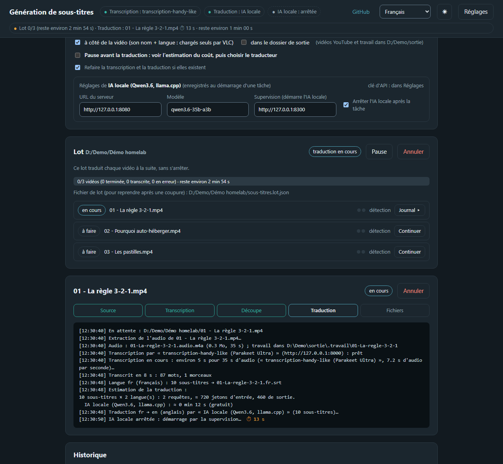
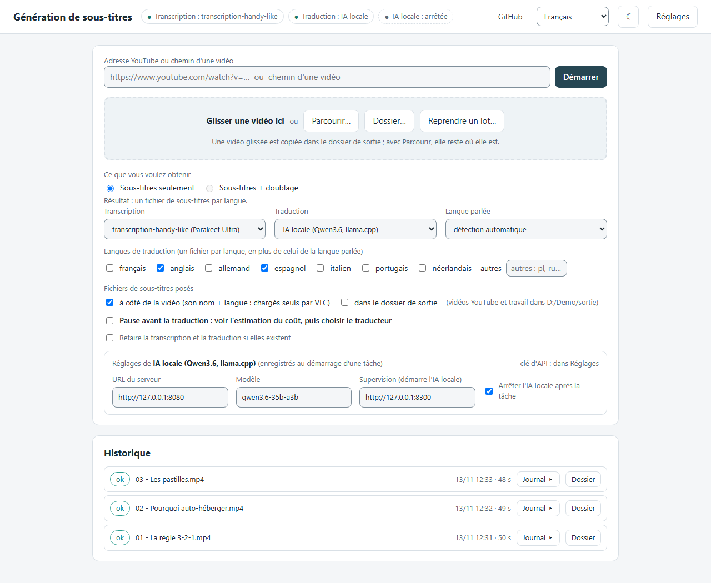
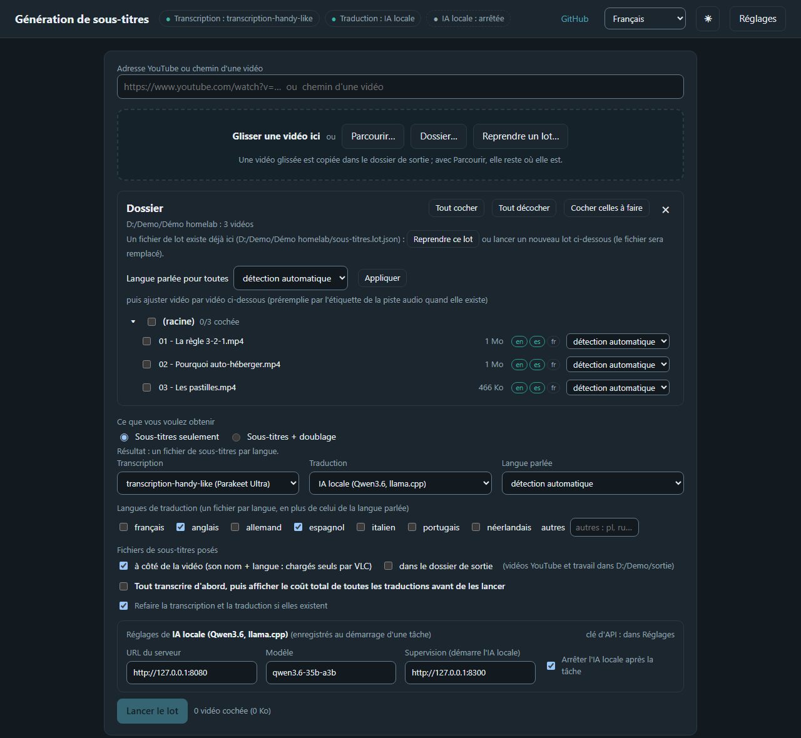
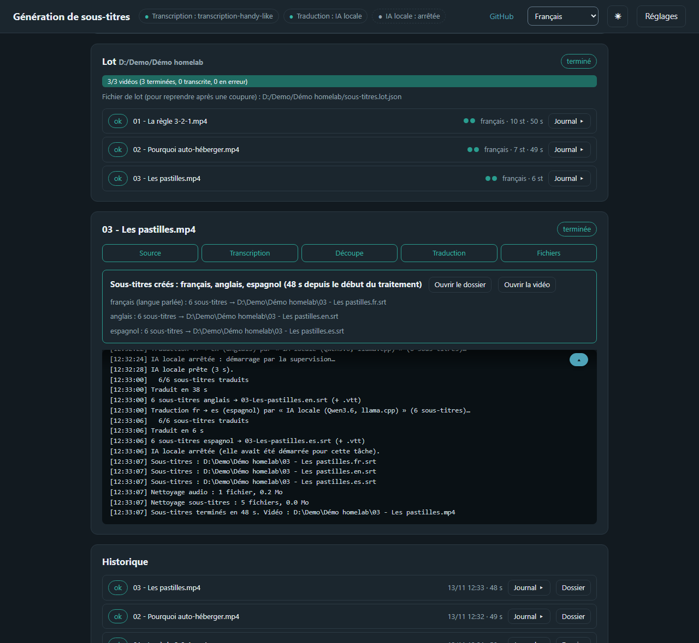
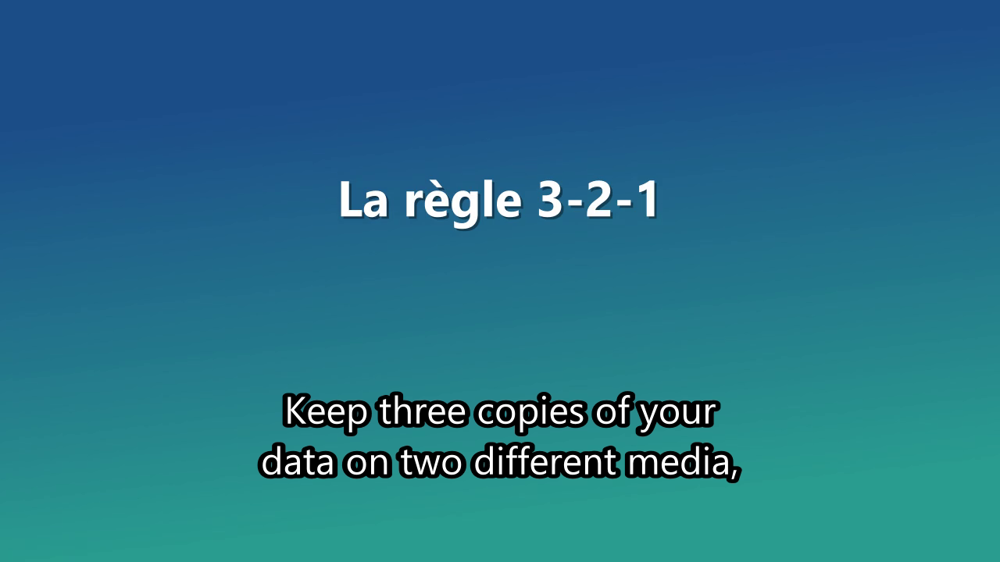

<div align="center">

# dl-sub-dub

**Télécharge une vidéo ou une playlist du web (YouTube, Dailymotion, PeerTube, Arte…), ou prend un fichier ou un dossier entier, et en tire des sous-titres calés sur la parole dans les langues voulues, et une version doublée si vous le souhaitez. Le téléchargement et le doublage sont facultatifs : *dl*-sub-*dub*.**

[](https://www.python.org)
[](pyproject.toml)
[](https://ffmpeg.org)
[](#interface-web)
[](#chaîne)
[](https://github.com/DamienBecherini/transcription-handy-like)
[](LICENSE)

**Français** · [English](README.md)

</div>

---

Télécharge une vidéo ou une playlist en ligne (essayé avec YouTube, Dailymotion, PeerTube et Arte ; d'autres [sites pris en charge par yt-dlp](https://github.com/yt-dlp/yt-dlp/blob/master/supportedsites.md) peuvent fonctionner, sauf ceux qui exigent un compte), ou prend un fichier vidéo ou un dossier, et le sous-titre dans sa langue et dans les langues voulues. La transcription passe par un serveur compatible OpenAI que vous fournissez ; la traduction par une IA locale, l'API Claude, toute API compatible OpenAI, ou rien. Les fichiers `.srt` et `.vtt` sont calés sur la parole. En option, la vidéo est doublée dans une langue traduite avec la voix d'origine clonée (carte graphique nécessaire), le tout réuni dans un MKV. Interface web locale ou ligne de commande.



## Captures d'écran

| Choisir les moteurs et les langues | Choisir les vidéos d'un dossier |
|---|---|
| [](docs/images/fr/home-light.png) | [](docs/images/fr/folder-dark.png) |
| **Lot terminé : un fichier par langue** | **Le résultat, ici en anglais** |
| [](docs/images/fr/batch-done-dark.png) | [](docs/images/fr/result-en.png) |

Les vidéos de démonstration sont fabriquées sur place (synthèse vocale de Windows, `docs/demo/videos_demo.py`) : une
narration en français, transcrite par [transcription-handy-like](https://github.com/DamienBecherini/transcription-handy-like/blob/main/README.fr.md)
et traduite en anglais et en espagnol par une IA locale (Qwen3.6 avec llama.cpp), sans frais.

## Démarrage rapide

**Avec un agent IA de code.** Ouvrez Claude Code, Codex, Cursor ou un autre agent sur la machine qui fera les sous-titres, et collez :

```
Install and configure dl-sub-dub from https://github.com/DamienBecherini/dl-sub-dub on this machine.
Follow its AGENTS.md. Ask me before anything that needs a password or administrator rights.
```

Il vérifie Python, `ffmpeg` et `yt-dlp`, cherche un serveur de transcription déjà lancé (ou propose d'installer [transcription-handy-like](https://github.com/DamienBecherini/transcription-handy-like/blob/main/README.fr.md) avec Docker), mesure la machine (processeur, mémoire, carte graphique), puis vous demande les langues voulues et recommande la façon de traduire : pas du tout, avec un modèle local adapté à votre matériel ou avec une API payante. Il écrit les réglages avec vous, les clés seulement sous forme de références, puis teste chaque moteur. [AGENTS.md](AGENTS.md) est la procédure qu'il suit. Un agent lance des commandes sur votre machine : lisez ce qu'il propose avant d'accepter.

**Ou à la main.**

**1. Lancez un serveur de transcription.** Cet outil envoie l'audio à un serveur que vous faites tourner. Utilisez **[transcription-handy-like](https://github.com/DamienBecherini/transcription-handy-like/blob/main/README.fr.md)** : son [démarrage rapide](https://github.com/DamienBecherini/transcription-handy-like/blob/main/README.fr.md#démarrage-rapide-sur-votre-ordinateur) tient en trois commandes avec Docker, et il écoute à l'adresse attendue ici par défaut.

**2. Installez cet outil.** Il faut Python 3.11 ou plus, ainsi que `ffmpeg` et `ffprobe` dans le `PATH`. `yt-dlp` ne sert que pour les adresses de vidéos.

```
git clone https://github.com/DamienBecherini/dl-sub-dub.git
cd dl-sub-dub
python -m venv .venv
.venv/bin/pip install .             # Windows : .venv/Scripts/python -m pip install .
.venv/bin/python -m subtitles.web --open
```

**3. Vérifiez la connexion.** Sur la page, ouvrez **Réglages**, puis cliquez sur **Tester** à côté du serveur de transcription. Si votre serveur est sur une autre machine ou demande une clé API, changez son adresse et sa clé à cet endroit.

**4. Créez des sous-titres.** Collez l'adresse d'une vidéo (YouTube, Dailymotion, PeerTube, Arte…) ou le chemin d'un fichier, puis cliquez sur **Démarrer**. Le fichier `.srt` apparaît à côté de la vidéo.

Pour traduire, ajoutez un traducteur dans **Réglages**. Pour l'API Claude, lancez d'abord `.venv/bin/pip install ".[claude]"`.

## Interface web

```
.venv/bin/python -m subtitles.web --open   # http://127.0.0.1:4420/
```

La page :

- **Adresse d'une vidéo ou chemin** + **Démarrer** (rien ne part avant ce clic). Une adresse (YouTube,
  Dailymotion, PeerTube, Arte…) affiche d'abord le titre, la durée et le fichier de destination ; la vidéo est téléchargée par yt-dlp
  **dans le dossier de téléchargement** (le dossier de sortie par défaut), où elle reste.
- **Playlist** (playlist ou chaîne YouTube, chaîne PeerTube…) : l'aperçu annonce le nombre de vidéos, la durée totale et
  le dossier, avec **Télécharger la playlist**. Les vidéos sont téléchargées une à une dans un dossier au nom de la
  playlist, numérotées dans l'ordre de la liste (`001 - titre.mp4`), avec une barre de progression et **Annuler** ;
  une vidéo impossible à télécharger (privée, supprimée) est sautée et signalée. Le dossier s'ouvre ensuite comme un
  dossier source (sélection, langue par vidéo, lot). Relancer reprend : les vidéos déjà là ne sont pas retéléchargées.
- **Glisser-déposer** une vidéo : le navigateur ne donne pas le chemin du fichier, il est donc **copié** dans le
  dossier de sortie (barre de progression) et son chemin remplit le champ. **Parcourir…** ouvre la boîte de dialogue
  du système (PowerShell sous Windows, `osascript` sur macOS, `zenity` ou `kdialog` sous Linux ; sans eux, saisir le chemin) et remplit le champ avec le fichier **là où il est** (les `.srt` sont posés à côté de lui).
- **Dossier…** (ou un chemin de dossier dans le champ + Démarrer) : inventaire de toutes les vidéos du dossier et de
  ses sous-dossiers, avec les sous-titres déjà présents à côté de chacune (`<nom>.<code>.srt`, en vert si c'est une
  langue demandée) et la langue parlée préremplie par l'étiquette de la piste audio. Cases par vidéo et par
  sous-dossier (**Tout cocher**, **Tout décocher**, **Cocher celles à faire** : celles à qui il manque une langue
  demandée, sélection par défaut), langue parlée pour toutes puis ajustable vidéo par vidéo, et **Lancer le lot**
  avec les options de la page. Le lot enchaîne une tâche par vidéo : toutes les transcriptions d'abord, puis
  (pause cochée) une **estimation cumulée** et **Traduire tout** avec le traducteur choisi à ce moment. **Pause**
  arrête le lot à la fin de la vidéo en cours ; **Arrêter** le met en pause tout de suite : la vidéo en cours
  s'interrompt en quelques secondes (le serveur de transcription est prévenu) et repartira de ce qu'elle a fini ;
  **Reprendre** relance le lot. Le bouton 🎨 choisit le mode (système, clair ou sombre) et une palette par mode :
  cinq claires et quatre sombres, dont trois sans lumière bleue ; le bouton soleil / lune bascule le mode. Mémorisé
  dans le navigateur. Une fois un travail lancé, les réglages de la page se replient en une ligne
  (**Modifier** les déplie) et se déplient d'eux-mêmes dès qu'on donne une nouvelle vidéo, un dossier ou une adresse.
- **Tout transcrire d'abord** (la case de pause, quand un dossier est ouvert) : le lot transcrit toutes les vidéos, puis
  affiche le coût cumulé de toutes les traductions pour chaque modèle, sans compter celles déjà faites et conservées.
- **Grand dossier** : la liste s'affiche dès le parcours fini, sous-dossiers repliés au-delà de trois (compteur de
  vidéos cochées par dossier, **Tout déplier**). La langue des pistes audio est lue ensuite en arrière-plan, avec une
  barre de progression. **Annuler** abandonne pendant la recherche ; pendant la lecture des langues, il garde la
  liste et laisse les vidéos non lues en détection automatique.
- **Lot en pause** : un panneau propose le serveur de transcription, le traducteur et les langues pour la suite
  (les listes du haut de la page le mettent à jour), appliqués au clic sur Reprendre aux vidéos pas encore lancées.
  Passer à une API payante redonne l'estimation du coût avant de dépenser.
- **Dernier lot** : à l'ouverture de la page, un lot resté inachevé à la session précédente (Pause, arrêt du service,
  coupure) est proposé dans un encadré : Reprendre le lot, Changer les réglages d'abord, ou Ignorer.
- **Fichier de lot** `subtitles.batch.json` (dans le dossier de sortie si cette destination est cochée, sinon dans
  le dossier source) : réécrit à chaque changement (sélection, langues, avancement). Après une coupure ou un
  redémarrage, **Reprendre un lot…** (ou le bouton proposé quand on rouvre le dossier) le relit : les vidéos
  terminées sont sautées, les autres repartent de la transcription, immédiate quand `transcription.json` a été gardé.
- Les réglages du traducteur choisi s'affichent sous les options (Claude : modèle, effort de réflexion ;
  API OpenAI : URL, modèle, supervision ; les références de clés sont dans Réglages) et sont enregistrés au clic sur Démarrer.
- Choix de la **transcription** (serveur distant, ou local : démarré à la demande quand il a une commande, coupé
  à la fermeture de l'interface), du **traducteur** (IA locale, Claude, API compatible OpenAI, aucun), de la
  **langue parlée** (détection automatique sinon), des **langues de traduction** (cases + codes libres : un fichier
  `<vidéo>.<code>.srt` par langue, en plus de celui de la langue parlée, toujours produit), de la **destination**
  des fichiers (à côté de la vidéo, coché par défaut ; dans le dossier de sortie ; les deux) et du **dossier de
  sortie** (Parcourir… ouvre le sélecteur de dossier). Langues et destination sont mémorisées au clic sur Démarrer.
- **Pause avant la traduction** (cochée d'office pour Claude ou une API distante, pas pour l'IA locale) : la tâche
  s'arrête après les sous-titres dans la langue parlée et affiche l'**estimation** (requêtes, jetons, prix pour chaque
  modèle Claude configuré, durée pour l'IA locale ; constantes mesurées dans `[estimation]` de `subtitles/config.toml`, à
  ajuster quand les prix changent). On choisit alors le traducteur et les langues, puis **Traduire** (confirmation
  pour Claude) ou **Terminer sans traduire**. Le journal donne ensuite les jetons réellement consommés et leur coût.
- Suivi de la tâche : étapes, journal en direct, **Annuler** (prend effet à la fin de l'étape en cours), puis
  boutons **Ouvrir le dossier** et **Ouvrir la vidéo**. Historique des 50 dernières tâches (`history.json`, à côté de `config.json`) ; le journal complet de chaque tâche est écrit à sa fin dans `.work/<nom>/log-<date>-<id>.txt` et s'ouvre en accordéon dans sa ligne d'historique (bouton Journal), sans quitter le suivi de la tâche en cours.
- **Réglages** : dossier de sortie, langue parlée par défaut, **téléchargements** (dossier des vidéos téléchargées, en
  chemin Windows comme `D:/Vidéos` même si yt-dlp tourne dans WSL : l'outil le convertit,
  qualité maximale, 1080p par défaut avec un son de 128 kb/s au plus, autres options de yt-dlp comme
  `--cookies-from-browser firefox`, commande yt-dlp), taille des lots de traduction, **nettoyage
  du dossier de travail** (voir plus bas, avec le bouton **Nettoyer maintenant** et la taille occupée par catégorie),
  mise en forme des sous-titres, et les listes de **serveurs de transcription** et de **traducteurs** (ajouter,
  modifier, supprimer, **Tester**, choisir l'actif). Enregistrés dans `config.json` du dossier utilisateur (`%LOCALAPPDATA%\subtitles` sous Windows, `$XDG_CONFIG_HOME/subtitles` ou `~/.config/subtitles` ailleurs), qui recouvre
  les valeurs par défaut de `subtitles/config.toml`.

**Arrêt automatique.** Après 60 min sans activité (`[web] idle_min`, réglable dans Réglages, 0 = jamais), le
service s'arrête et coupe le serveur de transcription local qu'il avait démarré. Le délai court à partir de la fin du
travail : une tâche ou un lot qui tourne n'est jamais interrompu. Un onglet resté ouvert ne compte pas comme une
activité. Une tâche ou un lot **en attente** (pause avant traduction, Pause) peut être coupé : le lot se reprend
par son fichier, une vidéo seule se relance, et dans les deux cas `transcription.json` évite de retranscrire.
`GET /api/health` suit le contrat « service local » : occupé ou non, activité en cours (`lot 3/22`), temps avant la fin du
travail et avant l'arrêt.

**Temps restant.** Calculé par le service et affiché sur la page. Il part de la
durée de chaque vidéo (ou du nombre de lignes pour une traduction) et de la vitesse observée sur les vidéos du lot. Avant
la première mesure, il reprend la vitesse retenue des sessions précédentes (`speeds.json`, à côté de `config.json`),
sinon le champ `speed` du serveur de transcription. Une vidéo reprise en quelques secondes n'est pas comptée.

**Clés d'API.** Jamais saisies ni affichées : le champ « Clé » est une référence `env:<NOM>` (variable
d'environnement), `file:<chemin>` (fichier qui contient la clé, hors du dépôt) ou `sops:<fichier>#<NOM>` (déchiffrée
au moment de l'usage, si sops est installé). Une valeur en clair est refusée à l'enregistrement.

**Vos réglages** (dossier de sortie, serveurs, traducteurs) sont dans `config.json` du dossier utilisateur, qui recouvre
les valeurs par défaut de `subtitles/config.toml` : ce dernier ne contient que des exemples.

**IA locale.** Un traducteur compatible OpenAI peut indiquer une adresse de supervision (`POST /api/ai/start`) qui démarre le modèle à la demande et l'arrête à la fin de la tâche. Ce réglage est facultatif : sans lui, le serveur doit déjà tourner.

## Chaîne

1. **Source.** Adresse : `yt-dlp` (commande réglable, y compris au travers de WSL) avec `-o` remplacé par le dossier de
   téléchargement, et le format choisi dans les réglages (`-f`, `--merge-output-format`, nouvelles tentatives) ; le
   fichier de configuration de yt-dlp reste lu pour le reste (cookies, moteur JavaScript…). Une vidéo déjà présente
   n'est pas retéléchargée. Puis, comme pour un fichier, `ffmpeg` extrait la piste audio
   (copie du flux, sans réencodage quand le conteneur le permet) dans `<output_dir>/.work/<nom>/`.
2. **Transcription.** L'audio part au serveur de transcription (`POST /v1/audio/transcriptions`,
   `response_format=verbose_json`) qui renvoie chaque **mot avec son début et sa fin** sur la ligne de temps de la
   vidéo (dépôt `transcription-handy-like` ≥ 0.2, mode horodaté). Résultat dans `transcription.json`.
3. **Découpe.** Mots regroupés en phrases (ponctuation finale ou pause ≥ 0,6 s), puis en sous-titres de 2 lignes
   × 42 caractères et 6 s au plus, coupés de préférence après une ponctuation ou dans une pause ; chaque
   sous-titre reste au moins 1 s (ou le temps de le lire à 17 caractères/s) sans empiéter sur le suivant.
   Sous-titres dans la langue d'origine : `<nom>.<langue>.srt` (pour vérifier la synchronisation).
4. **Traduction**, une par langue cible (`target_languages`, la langue parlée étant sautée). Lots de 25 lignes
   numérotées avec les deux lignes précédentes en contexte ; le modèle doit rendre les mêmes numéros (lot
   incomplet : renvoyé, puis lots plus petits ; en dernier recours la ligne reste dans sa langue, signalée). Les
   **temps ne changent pas** ; un texte devenu trop long pour deux lignes est partagé en deux sous-titres au
   prorata des caractères. Résultat : `translation.<code>.json`, `<nom>.<code>.srt`, `<nom>.<code>.vtt`.
5. **Fichiers.** Chaque `.srt` (langue parlée et langues cibles) est copié au nom de la vidéo + code de langue
   (`Ma vidéo.en.srt`, `Ma vidéo.fr.srt`) **à côté de la vidéo** (VLC et la plupart des lecteurs les chargent
   seuls) et/ou **dans le dossier de sortie**, selon la table `[destination]` (ou les cases de la page).
6. **Nettoyage** du dossier de travail selon la table `[cleanup]` : par défaut l'audio extrait et les copies
   `.srt`/`.vtt` sont supprimés ; `transcription.json` et `translation.<code>.json` sont gardés (ajouter une langue
   ou changer la mise en forme sans retranscrire ni retraduire), les journaux aussi, mais ceux de plus de 48 h
   (`logs_age_h`) sont purgés au démarrage de l'interface. Si aucune destination n'est cochée, les `.srt` du
   dossier de travail sont gardés (seule copie). `--no-cleanup` en ligne de commande garde tout.

Chaque étape est sautée si son résultat existe déjà (case « Refaire… » ou `--redo` pour recommencer) ; une
vidéo dont l'audio a été nettoyé mais dont `transcription.json` existe n'est ni réextraite ni retranscrite.

Un `.srt` modifié à la main depuis sa création n'est pas écrasé (sauf « Refaire… ») ; le doublage et le MKV utilisent alors cette version.

## Lots : étapes par vidéo

`Transcription → Relecture IA → Validation → Traduction → Doublage → MKV`. Chaque vidéo du lot montre ses étapes par des
pastilles, relues sur le disque : une étape faite n'est pas refaite, même après un redémarrage.

- Dès le départ, pour une vidéo comme pour un lot : « Sous-titres seulement » ou « Sous-titres + doublage ». Les pastilles, les boutons
  et les étapes s'y adaptent. Un lot peut changer d'objectif ensuite : passer au doublage ne lance rien avant « Reprendre » ou « Continuer ».
- « Continuer » fait passer un seul épisode jusqu'au bout de ce que le lot doit produire, avant les autres.
- La relecture IA (Claude) repère les noms propres déformés. Un nom n'est soumis qu'une fois par lot. Rien n'est corrigé sans
  validation : les noms acceptés vont dans `subtitles.glossary.json` et `transcription.json` n'est jamais réécrit.
- Le doublage (table `[dubbing]` des réglages, désactivé par défaut) clone la voix d'origine phrase par phrase dans la
  première langue traduite. Il demande un environnement Python séparé avec `torch`, `demucs`, `omnivoice`, `soundfile`,
  `num2words`, ainsi que `ffmpeg` et une carte graphique (environ 4,3 Go de mémoire vidéo, 8 min 30 pour 30 min de vidéo).
  Un clonage de voix suppose le droit d'utiliser la voix et le contenu d'origine.
- Le MKV `<vidéo>.multi.mkv` est créé à côté de la vidéo, sans réencodage et sans toucher à l'original : pistes d'origine,
  piste doublée et sous-titres de chaque langue. Une option le met à la place de la vidéo, sous le nom `<vidéo>.mkv`, une fois
  ses pistes et sa durée vérifiées ; l'original part à la corbeille, et sans corbeille disponible les deux fichiers sont gardés.

## Langues

La page, le journal des tâches, les messages d'erreur et la ligne de commande existent en français et en anglais.

- **Page web** : elle suit la langue du navigateur. Le sélecteur en haut de la page l'impose ; le choix est enregistré (réglage `ui_language`) et le journal des tâches le suit aussi.
- **Ligne de commande** : `--lang`, sinon le réglage `ui_language`, sinon la langue du système.
- **API** : l'en-tête `X-Language: fr` (ou `en`) donne les messages d'erreur dans cette langue.

**Ajouter une langue** demande un fichier, pas de code : copier `subtitles/locales/en.json` sous `<code>.json` (par exemple `de.json`) et traduire les valeurs, en gardant les `{paramètres}` tels quels. Un texte qui dépend d'un nombre a une forme par catégorie de pluriel (`one`, `other`, plus `few` ou `many` pour les langues qui en ont besoin). Un texte absent retombe sur l'anglais, et la langue apparaît d'elle-même dans le sélecteur. Les noms de langues viennent du navigateur : rien à traduire pour eux. `pytest` vérifie que chaque fichier a les mêmes clés et les mêmes paramètres que `en.json`.

Les noms des réglages, les options de la ligne de commande et les champs de l'API sont en anglais : ce sont des identifiants, pas du texte.

## Ligne de commande

```
.venv/bin/python -m subtitles "https://www.youtube.com/watch?v=…"
.venv/bin/python -m subtitles "https://www.youtube.com/playlist?list=…"   # toute la playlist, en lot
.venv/bin/python -m subtitles "ma video.mp4" --transcription local --translator claude
.venv/bin/python -m subtitles "D:/Séries/Saison 1"   # toutes les vidéos du dossier, en lot
.venv/bin/python -m subtitles --list          # moteurs configurés
```

Options : `--output-dir`, `--language en` (langue parlée), `--languages fr,de` (langues cibles), `--transcription <id>`,
`--translator <id>`, `--redo`, `--no-cleanup`, `--lang fr` (langue des messages). Le traducteur Claude demande le SDK `anthropic` (`pip install ".[claude]"`).

Un dossier devient un lot, comme dans l'interface web : `subtitles.batch.json` note l'avancement, et relancer la même
commande après une coupure (Ctrl+C, panne) reprend le lot. Les vidéos faites sont sautées, les autres repartent de leur
transcription conservée. La commande ne fait pas de pause avant la traduction. Options des lots : `--until
translation|dubbing|mux` (dernière étape, la traduction par défaut), `--new-batch` (ignore le fichier de lot
existant et refait l'inventaire du dossier), `--no-subfolders`. On peut aussi donner un fichier `.batch.json`. Code de
sortie : 0 si toutes les vidéos sont faites, 1 sinon. Ne pas mener le même lot en même temps dans l'interface web.

Une adresse de playlist est téléchargée dans un dossier à son nom (dans le dossier de téléchargement), puis ce dossier
est traité comme un lot ; relancer la commande reprend le téléchargement puis le lot. L'adresse d'une vidéo d'une
playlist (`watch?v=…&list=…`) ne traite que cette vidéo, ou toute la liste avec `--playlist`.

Vérifier dans VLC : ouvrir la vidéo, le `.fr.srt` du même nom se charge seul (sinon Sous-titres > Ajouter un
fichier). Regarder le début, le milieu et la fin : un décalage qui grandirait au fil de la vidéo signalerait un
problème de cadence (les temps viennent du modèle, pas d'une estimation).

## API

L'interface web s'appuie sur une API JSON locale, sur `http://127.0.0.1:4420`, utilisable aussi par des scripts. Elle n'a
pas d'authentification : elle n'écoute que sur la machine elle-même, et refuse les requêtes envoyées par d'autres sites ouverts dans le navigateur (en-têtes `Origin` et `Host` vérifiés ; `curl` et les scripts sont acceptés). Les messages d'erreur suivent l'en-tête `X-Language` (`fr`, `en`). Chaque route est une fonction marquée `@route` dans `subtitles/web/server.py`, avec les champs attendus dans sa docstring.

| Requête | Rôle |
| --- | --- |
| `POST /api/tasks` `{source, languages?, translator?, transcription?, output_dir?, pause?}` | une vidéo (fichier ou adresse) → tâche |
| `GET /api/tasks/<id>?since=N` | état, étape en cours, lignes du journal à partir de N |
| `POST /api/tasks/<id>/translate` `{translator?, languages?}` | suite d'une tâche en pause avant la traduction |
| `POST /api/folder` `{path}` puis `GET /api/folder/<id>?videos=1` | inventaire des vidéos d'un dossier |
| `POST /api/youtube` `{url}` | titre et durée d'une adresse de vidéo, ou la playlist qu'elle désigne, sans rien télécharger |
| `POST /api/playlist` `{url}` puis `GET /api/playlist/<id>` | télécharger toute une playlist dans un dossier, à ouvrir ensuite avec `/api/folder` |
| `POST /api/batches` `{root, videos: [{path, language}], languages?, translator?, pause?, stop?}` | lancer un lot |
| `GET /api/batches/<id>` | avancement : `state`, `phase`, `step` (étape de la vidéo en cours), comptes, temps restant |
| `POST /api/batches/load` `{file}` puis `POST /api/batches/<id>/resume` | reprendre d'après un `subtitles.batch.json` |
| `POST /api/batches/<id>/suspend`, `stop`, `cancel`, `translate` | piloter un lot (`suspend` : après la vidéo en cours ; `stop` : tout de suite, la vidéo revient dans la liste) |
| `GET /api/health` | occupé ou non, activité, temps restant (voir plus haut) |

```
curl -s -X POST localhost:4420/api/batches -H "Content-Type: application/json"   -d '{"root": "D:/Séries/S1", "videos": [{"path": "D:/Séries/S1/e01.mkv"}], "languages": ["fr"], "pause": false}'
curl -s localhost:4420/api/batches/<id>
```

## Prérequis

**Serveur de transcription.** Il faut un serveur compatible avec l'API d'OpenAI qui renvoie les mots horodatés :
`POST /v1/audio/transcriptions` avec `response_format=verbose_json` et `timestamp_granularities[]=word`, et une réponse
contenant `words: [{"word", "start", "end"}]`, sur la ligne de temps de l'enregistrement. Sans ce champ, la tâche s'arrête
avec un message clair : un serveur qui ne renvoie que des segments ne suffit pas. La route `/health` est facultative.
Serveurs essayés : [transcription-handy-like](https://github.com/DamienBecherini/transcription-handy-like/blob/main/README.fr.md) (recommandé) et l'image Docker `hwdsl2/whisper-server` (modèle Whisper tiny, sur processeur).

## Développement

```
.venv/bin/pip install -e ".[dev,claude]"
.venv/bin/pytest -q
.venv/bin/ruff check .
```

## Licence

MIT, voir [LICENSE](LICENSE).
