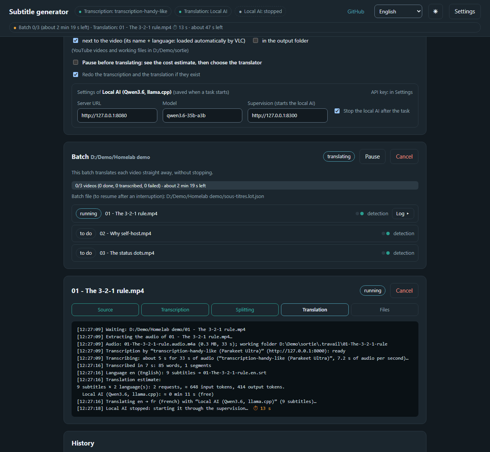
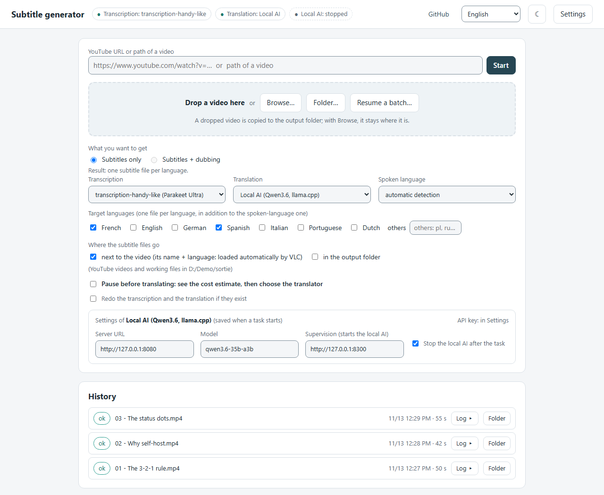
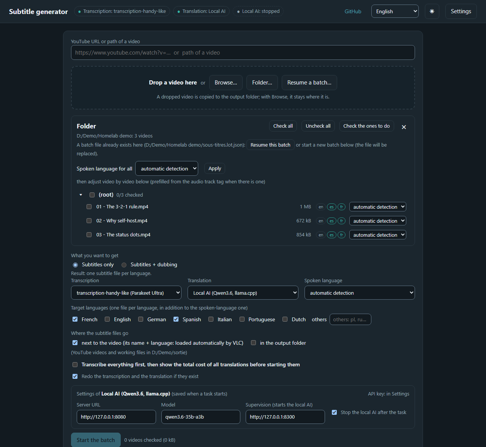
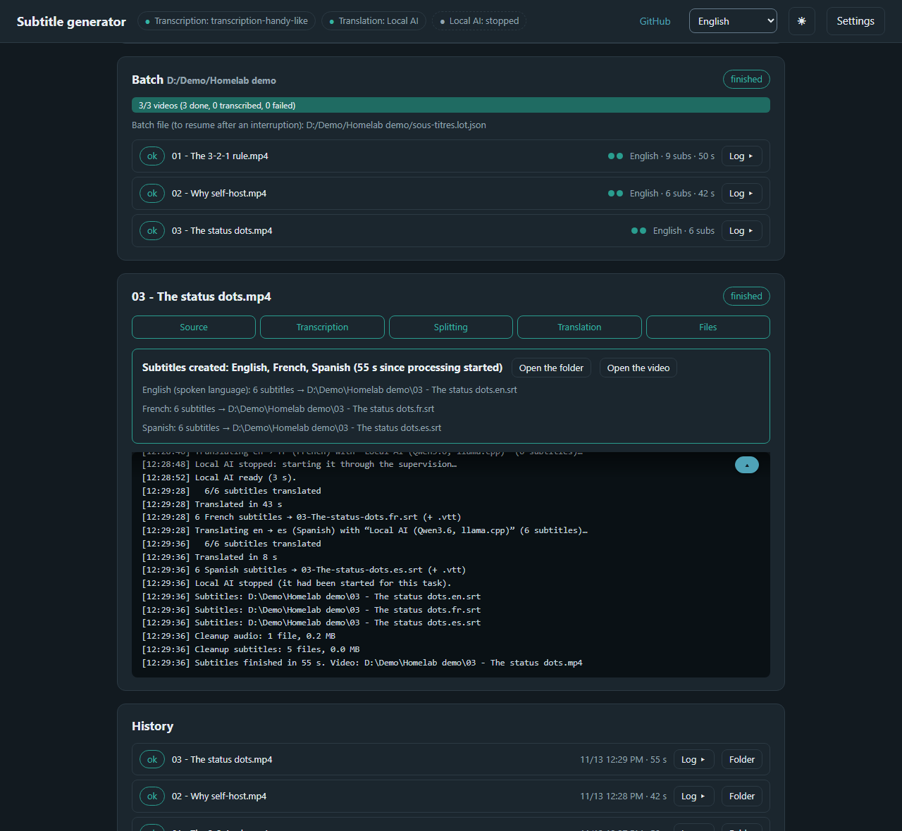
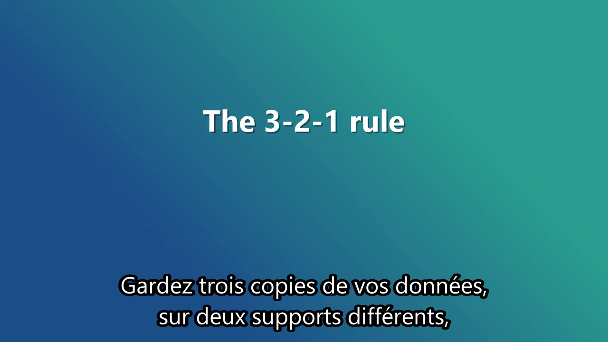

<div align="center">

# auto-generate-subtitles

**Subtitles for a YouTube video, a file or a whole folder, timed on the actual speech, in the languages you want.**

[](https://www.python.org)
[](pyproject.toml)
[](https://ffmpeg.org)
[](#what-it-does)
[](#how-it-works)
[](https://github.com/DamienBecherini/transcription-handy-like)
[](LICENSE)

**English** · [Français](README.fr.md)

</div>

---

Subtitles for a YouTube video or a video file, in its own language and in the languages you want. You bring the transcription server; translation runs on a local LLM, the Claude API, any OpenAI-compatible API, or not at all. Output is `.srt` and `.vtt` files timed on the actual speech.



## What it does

- **One video or a whole folder.** A folder becomes a batch you can pause, resume after a power cut, and retry video by video.
- **Cost before spending.** With a paid translator, the batch stops after transcription and shows the estimated tokens and price for each model.
- **No retyped work.** Each step is skipped when its result already exists: changing a language or the layout does not transcribe again.
- **Web page or command line.** The page shows steps, live log and remaining time. It runs on your machine and listens on `127.0.0.1` only.
- **Subtitles only, or dubbing too.** Choose at the start. Check one episode end to end before running the rest of a batch, and validate AI-corrected names before translating.

## Screenshots

| Choose the engines and the languages | Pick the videos of a folder |
|---|---|
| [](docs/images/en/home-light.png) | [](docs/images/en/folder-dark.png) |
| **Batch done: one file per language** | **The result, here in French** |
| [](docs/images/en/batch-done-dark.png) | [](docs/images/en/result-fr.png) |

The demo videos are made on the spot (Windows speech synthesis, `docs/demo/videos_demo.py`): an English narration,
transcribed by [transcription-handy-like](https://github.com/DamienBecherini/transcription-handy-like) and translated
into French and Spanish by a local LLM (Qwen3.6 with llama.cpp), at no cost.

## Quick start

**1. Start a transcription server.** This tool sends the audio to a server you run. Use **[transcription-handy-like](https://github.com/DamienBecherini/transcription-handy-like)**: its [quick start](https://github.com/DamienBecherini/transcription-handy-like#quick-start-on-your-computer) takes three commands with Docker, and it listens on the address expected here by default.

**2. Install this tool.** You need Python 3.11 or later, and `ffmpeg` and `ffprobe` in the `PATH`. `yt-dlp` is needed for YouTube addresses only.

```
git clone https://github.com/DamienBecherini/auto-generate-subtitles.git
cd auto-generate-subtitles
python -m venv .venv
.venv/bin/pip install .             # Windows: .venv/Scripts/python -m pip install .
.venv/bin/python -m soustitres.web --ouvrir
```

**3. Check the connection.** On the page, open **Settings**, then click **Test** next to the transcription server. If your server is on another machine or uses an API key, change its address and key there.

**4. Make subtitles.** Paste a YouTube address or a file path, then click **Démarrer**. The `.srt` file appears next to the video.

To translate, add a translator in **Settings**. For the Claude API, first run `.venv/bin/pip install ".[claude]"`.

## Transcription server requirements

Any server can be used if it meets this contract. The tool needs an OpenAI-compatible server that returns **word timestamps**: `POST /v1/audio/transcriptions` with `response_format=verbose_json` and `timestamp_granularities[]=word`, answering `words: [{"word", "start", "end"}]` on the recording's timeline. A server that only returns segments is refused with a clear message. A `/health` route is optional.

Tested with [transcription-handy-like](https://github.com/DamienBecherini/transcription-handy-like) (recommended) and the Docker image `hwdsl2/whisper-server`.

## Use

```
.venv/bin/python -m soustitres.web --ouvrir        # web page on http://127.0.0.1:4420/
.venv/bin/python -m soustitres "https://www.youtube.com/watch?v=..."
.venv/bin/python -m soustitres "my video.mp4" --langues fr,de
.venv/bin/python -m soustitres "D:/Series/Season 1"      # every video in the folder, as a batch
.venv/bin/python -m soustitres --liste              # configured engines
```

Command line options: `--sortie`, `--langue en` (spoken language), `--langues fr,de` (target languages), `--transcription <id>`, `--traducteur <id>`, `--refaire`, `--sans-nettoyage`, `--lang en` (language of the messages).

A folder becomes a batch, the same as in the web page: `sous-titres.lot.json` records its progress, and running the same command after an interruption (Ctrl+C, power cut) resumes it. Finished videos are skipped and the others reuse their saved transcription. The command does not pause before translation. Batch options: `--jusqua traduction|doublage|assemblage` (last step, translation by default), `--nouveau-lot` (ignore the existing batch file and list the folder again), `--sans-sous-dossiers`. You can also pass a `.lot.json` file. The exit code is 0 when every video is done, 1 otherwise. Don't run the same batch in the web page at the same time.

File pickers use the system dialog: PowerShell on Windows, `osascript` on macOS, `zenity` or `kdialog` on Linux. Without any of them, type the path in the field.

## Step-by-step batches

`Transcription → AI review → Validation → Translation → Dubbing → MKV`. Each video in a batch shows its steps as dots, read from disk: a finished step is not redone, even after a restart.

- **Choose at the start**, for one video or a batch: *subtitles only*, or *subtitles + dubbing*. The steps and buttons follow. A batch can change its goal later; switching to dubbing starts nothing until you click **Resume** or **Continue**.
- **Continue** takes one episode to the end of what the batch must produce, ahead of the others, so you can check it before running the rest.
- **AI review** (needs a Claude translator, a few cents per video) finds proper names the transcription distorted. Nothing changes without your validation. Accepted names go to `sous-titres.glossaire.json`, and `transcription.json` is never rewritten.
- A `.srt` you edited by hand is not overwritten, unless you tick the redo option. Dubbing and the MKV then use your version.

### Dubbing (optional, off by default)

It clones the original voice sentence by sentence in the first translated language, keeps the background sound, and needs a graphics card (about 4.3 GB of video memory, and about 8 min 30 for 30 min of video on the machine used for testing). **Only clone a voice and dub content you have the right to use.**

It runs in a separate Python environment with `torch`, `demucs`, `omnivoice`, `soundfile` and `num2words`, plus `ffmpeg`. Set it up in the `[doublage]` table of your settings: `actif`, `commande` (the Python of that environment), `modele` (a Hugging Face id or a local folder), and `wsl = true` if the command goes through WSL.

The result is `<video>.multi.mkv` next to the video: original tracks copied without re-encoding, the dubbed track, and the subtitles of each language. An option puts it in place of the video as `<video>.mkv`, once its tracks and duration are checked. The original goes to the recycle bin. If there is no recycle bin, both files are kept.

## Settings

Open **Settings** on the page. Your settings are saved in `config.json` in the user folder (`%LOCALAPPDATA%\sous-titres` on Windows, `$XDG_CONFIG_HOME/sous-titres` or `~/.config/sous-titres` elsewhere). They override the defaults shipped in `soustitres/config.toml`, which only contains examples.

**API keys are never stored in clear text.** The key field holds a reference, and a plain value is refused:

| Reference | Meaning |
| --- | --- |
| `env:<NAME>` | environment variable |
| `file:<path>` | file containing the key, outside the repository |
| `sops:<file>#<NAME>` | decrypted when used, if sops is installed |

## Languages

The page, the task logs, the error messages and the command line are in English and French.

- **Web page**: it follows the browser language. The selector at the top of the page fixes it; the choice is saved (`langue_interface` setting) and the task logs follow it too.
- **Command line**: `--lang`, otherwise the `langue_interface` setting, otherwise the system language.
- **API**: send `X-Langue: en` (or `fr`) to get error messages in that language.

**Adding a language** takes one file and no code: copy `soustitres/locales/en.json` to `<code>.json` (for example `de.json`) and translate the values. Keep the `{placeholders}` as they are. A text that depends on a number has one form per plural category (`one`, `other`, plus `few` or `many` where the language needs them). A missing text falls back to English, and the new language shows up in the selector by itself. Language names come from the browser, so there is nothing to translate for them. `pytest` checks that every file has the same keys and placeholders as `en.json`.

The setting names, the command line options and the API fields stay in French: they are identifiers, not text.

## How it works

1. **Source.** `yt-dlp` downloads the video into the output folder if needed, then `ffmpeg` extracts the audio.
2. **Transcription.** The audio goes to your server; the result is kept in `transcription.json`.
3. **Cutting.** Words are grouped into sentences, then into subtitles of at most 2 lines of 42 characters and 6 seconds.
4. **Translation.** Numbered batches of 25 lines, with context. Timings do not change.
5. **Files.** Each `.srt` is copied next to the video, where most players load it automatically, and/or into the output folder.
6. **Cleanup.** Extracted audio is removed; `transcription.json` and translations are kept.

## Local service

`GET /api/sante` reports whether the service is busy, its current activity (`lot 3/22`), the time left and the idle countdown. After 60 minutes without activity the service stops by itself; running work is never interrupted.

## HTTP API

The web page uses a local JSON API on `http://127.0.0.1:4420`, which scripts can use too. It has no authentication: it only listens on the local machine. Error messages follow the `X-Langue` header (`en`, `fr`). The full list is at the top of `soustitres/web/serveur.py`.

| Request | Purpose |
| --- | --- |
| `POST /api/taches` `{source, langues?, traducteur?, transcription?, sortie?, pause?}` | one video or YouTube URL → task |
| `GET /api/taches/<id>?depuis=N` | state, current step, log lines from N |
| `POST /api/taches/<id>/traduire` `{traducteur?, langues?}` | continue a task paused before translation |
| `POST /api/dossier` `{chemin}` then `GET /api/dossier/<id>?videos=1` | list the videos of a folder |
| `POST /api/lots` `{racine, videos: [{chemin, langue}], langues?, traducteur?, pause?, arret?}` | start a batch |
| `GET /api/lots/<id>` | progress: `etat`, `phase`, `etape` (step of the running video), counts, time left |
| `POST /api/lots/charger` `{fichier}` then `POST /api/lots/<id>/reprendre` | resume from a `sous-titres.lot.json` |
| `POST /api/lots/<id>/suspendre`, `annuler`, `traduire` | control a batch |
| `GET /api/sante` | busy or not, activity, time left (see above) |

```
curl -s -X POST localhost:4420/api/lots -H "Content-Type: application/json"   -d '{"racine": "D:/Series/S1", "videos": [{"chemin": "D:/Series/S1/e01.mkv"}], "langues": ["fr"], "pause": false}'
curl -s localhost:4420/api/lots/<id>
```

## Development

```
.venv/bin/pip install -e ".[dev,claude]"
.venv/bin/pytest -q
.venv/bin/ruff check .
```

## License

MIT, see [LICENSE](LICENSE).
